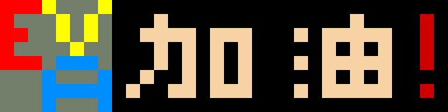
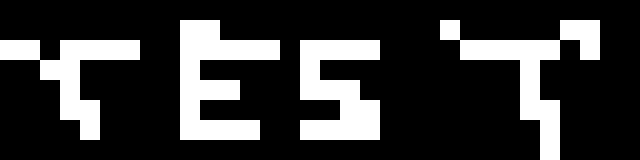

# LocalAnimations - AWTRIX 2 本地 GIF 动画 App

`LocalAnimations.jar` 是用于 AWTRIX 2 Docker 后台的本地动画 App。它已将 GIF 动画预转换为 AWTRIX 的 32 × 8 RGB565 帧，运行时不访问网络、不依赖云端动画服务。

## 示例动画

以下示例均来自本项目的本地 GIF 库；实际显示到 AWTRIX 时会自动缩放至 32 × 8 像素。

      

## 安装到 AWTRIX 2 Docker

1. 在此项目中找到部署文件：[LocalAnimations.jar]。
2. 将该 JAR 复制到 AWTRIX 2 Docker 容器的 `Apps` 目录，或复制到映射至容器 `Apps` 目录的宿主机文件夹。
3. 打开 AWTRIX 网页后台，在“我的应用”中重新加载 App；如没有重新加载按钮，重启 AWTRIX 容器。
4. 在“我的应用”中找到并启用 `LocalAnimations`。
5. 点击 `LocalAnimations` 右侧的设置图标，在“应用设置”中勾选需要参与随机轮播的动画，然后保存。

> 若将所有动画取消勾选，`LocalAnimations` 会自动跳过，不占用 AWTRIX 的应用轮播。

## 更新或添加 GIF

1. 将 GIF 文件放入 `E:\awtrix\LocalAnimations\gif`。文件必须使用 `.gif` 后缀。
2. 在 `E:\awtrix` 运行生成脚本：

```powershell
.\generate_local_animations.ps1
```

3. 使用 B4J 编译项目：

```powershell
& 'C:\Program Files\Anywhere Software\B4J\B4JBuilder.exe' -Task=BuildLibrary -BaseFolder='E:\awtrix\LocalAnimationsApp' -Project='LocalAnimations.b4j'
```

4. 用新生成的 `Libraries\LocalAnimations.jar` 替换 Docker `Apps` 目录中的旧文件，再重新加载或重启 AWTRIX。

## 注意事项

- 空文件或损坏的 GIF 会被生成脚本自动跳过。
- GIF 会被压缩以适应 32 × 8 的 AWTRIX 显示区域，细节较多的大图会损失细节。
- 当前 App 的设置界面按名称和开关选择动画。若要为每一项提供后台缩略图，需要额外修改 AWTRIX Docker 后台前端。
